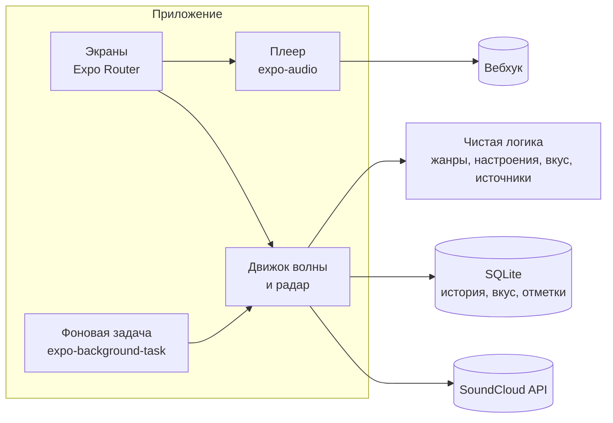

<div align="center">


<h1>SoundCloud Mobile</h1>

<p>Мобильный клиент SoundCloud для Android со своей «Моей волной», фоновым воспроизведением и пятничным радаром релизов.</p>

<a href="https://github.com/claudecodeb2bsaas/soundcloud-mobile-apk/releases/latest"></a>

<sub>Готовый <code>.apk</code> лежит в Releases, а свежие сборки из <code>main</code> в <a href="https://github.com/claudecodeb2bsaas/soundcloud-mobile-apk/actions/workflows/android-apk.yml">Actions</a></sub>

<a href="#моя-волна">Моя волна</a>&emsp;<a href="#радар-релизов">Радар релизов</a>&emsp;<a href="#история-и-вкус">История и вкус</a>&emsp;<a href="#что-ещё-есть-в-приложении">Что ещё есть</a>&emsp;<a href="#установка-apk">Установка APK</a>

</div>

<br>


Это SoundCloud в телефоне, только главная другая: вместо полок сайта твоя волна, подборки на день и пятничный радар релизов. Приложение ведёт журнал того, что ты слушаешь, по нему подбирает треки и показывает «Мой вкус». Журнал и модель вкуса лежат в SQLite на самом телефоне и никуда не уходят.

<sub>Иллюстрации в этом README сняты в десктопной версии, из которой перенесены алгоритмы. На телефоне те же блоки, только в мобильной раскладке.</sub>

## Моя волна

Жмёшь «Включить волну», и приложение собирает бесконечную очередь из похожего на то, что ты слушаешь и лайкаешь. Пока трек играет, очередь дозагружается, один артист не идёт подряд, а в плеере подписано, почему трек оказался в волне. Что ещё умеет волна:

- **Похожее или новое**: «Похожее» подбирает треки вокруг твоих лайков и истории, «Новое» берёт треки в твоём вкусе, которых ты ещё не слышал. Жанры можно задать своими словами: `techno, фонк`.
- **Настроение**: пресеты «Весёлое», «Грустное», «Агрессивное», «Спокойное» и «Энергичное». Волна сверяет теги, жанры и слова в названии, а пропуски внутри пресета запоминает: если ты постоянно скипаешь именно в нём, этого станет меньше.
- **Вкус по тому, как ты слушаешь**: дослушанный трек, пропуск, быстрый скип в первые секунды и лайк меняют то, что волна поставит дальше. Утром, днём, вечером и ночью у неё свой вкус, а ещё она помнит, на каком языке ты слушаешь.
- **Серии пропусков**: если подряд скипаешь slowed, инструментал или один жанр, волна до конца сессии ставит такое реже и называет черту уведомлением, например «Меньше инструменталов в этой волне». Уведомление можно отменить. Трек, который ты дослушал, серию обрывает.
- **Развилки**: после трёх быстрых пропусков вместо следующего трека появляется шторка «Куда дальше?» с вариантами в разные стороны.
- **«Больше такого», «Не сейчас» и «Не нравится»**: первая добавляет в волну похожее, вторая убирает трек или артиста на неделю, третья навсегда. Здесь же скрытие аккаунта, и он пропадает из волны и радара.
- **Волна от чего угодно**: от трека, артиста, плейлиста или жанра (пункты меню у трека). «Все треки артиста» играют только его каталог.
- **Набор**: собери несколько треков пунктом «Добавить в набор», и волна пойдёт от них.
- **Версии трека**: волна различает оригинал, slowed, sped up, ремиксы и лайвы, а перезалив той же версии второй раз не ставит. «Версии этого трека» покажет остальные, «Скрыть другие версии» уберёт их из волны и радара.
- **Закрепления**: волну по любому треку, артисту или жанру можно закрепить на главной.

### Моя музыка

Блок с твоими лайками и плейлистами, своими и сохранёнными. В «Источниках» выбираешь, что играть, можно сразу несколько. Порядок на выбор: «По порядку» (плейлисты как на сайте, лайки от новых к старым), «Перемешать» (один артист не идёт подряд, слышанное за последние 3 дня не играет) или «Умное перемешивание», где после каждых трёх твоих треков идёт похожий, которого у тебя ещё нет. Отрывки Go+ и закрытое в твоей стране приложение помечает как недоступное: целиком SoundCloud их не отдаёт.


### Подборки на каждый день

Ниже каждый день новая полка. Нажми на карточку, и она раскроется списком треков:

- **Разведка**: треки, которых ты ещё не слышал, из похожих на любимое и из лайков слушателей с похожим вкусом. Каждый играет 20 секунд с самого яркого места: «Оставить» дослушивает его, «Дальше» переключает. Список обновляется в полночь.
- **Давно не слушал**: твои лайки, которые давно не звучали.
- **Лайкнули твои артисты**: что лайкают исполнители, которых ты слушаешь.
- **Твои вкусы**: приложение делит лайки и то, что ты дослушиваешь, на группы по жанрам. У каждой своя волна.


### Очередь и продолжение прослушивания

Очередь открывается с экрана плеера: любой трек можно поставить следующим или в конец, а будущие треки переставить и убрать. Очередь, источник волны и позиция сохраняются: после перезапуска приложение вернёт всё на место, а музыку подержит на паузе, пока не нажмёшь play.


## Радар релизов

Каждую пятницу в 9:00 приложение собирает выпуск: что вышло за неделю у тех, на кого ты подписан, и у артистов, которых слушаешь. День и время меняются в настройках, а о готовом выпуске сообщает уведомление. Сборка идёт в фоне через `expo-background-task`, поэтому приложение открывать не нужно.

- **Сначала твоё**: наверху треки, связанные с твоим вкусом, в конце до 10 открытий по твоим жанрам. От одного канала в выпуске не больше трёх треков.
- **Новые загрузки отдельно**: публикации без доказанной даты релиза (перезаливы, сборные каналы) идут своим блоком и в 50 релизов не входят.
- **Ремиксы и эдиты**: фанатские ремиксы чужих песен с каналов не из подписок тоже живут отдельно.
- **Группы релизов**: альбомы, EP и синглы собраны в одну строку. «Слушать все» ставит их следующими в очереди.
- **«Уже слышал»**: треки, которые ты уже слушал или лайкнул, помечены. Их можно скрыть фильтром.
- **Архив и «Все найденные»**: прошлые выпуски лежат в архиве, а «Все найденные» покажут всё остальное, что радар нашёл сверх 50 релизов основного списка. Выпуск можно пересобрать, прежний остаётся в архиве.
- **Честный охват**: если источники проверены не все, радар так и пишет, например «Проверено источников: 31 из 40».


Выпуск играет по порядку, после него волна продолжает похожим. Система сама решает, когда запустить фоновую задачу, так что уведомление может прийти позже. Если телефон был выключен, выпуск соберётся при следующем открытии приложения. Без разрешения на уведомления радар соберётся, но сообщить о себе не сможет, так что разреши их в настройках телефона.

## История и вкус

Каждое прослушивание пишется в SQLite на устройстве: что играло, сколько ты слушал, пропустил или дослушал, из какой подборки и в какое время суток. Трек засчитывается как дослушанный, если ты довёл его до последних трёх секунд, всё остальное смена человеком. Из этой истории строится модель вкуса.

- **Модель вкуса**: артисты, теги, ремиксеры и язык с затуханием в полгода. Вес складывается из долгой истории, последнего месяца и последней недели, поэтому вкус не залипает на прошлом. Трек, который ты недавно уже слушал, ставится реже.
- **«Мой вкус»**: экран с артистами, которых волна ставит чаще, и тегами, на которые она опирается. Лишнего артиста или тег можно убрать кнопкой «Убрать из вкуса», а вернуть из строки «Убрано из вкуса».
- **Отметки**: всё, что ты скрыл («Не нравится», скрытые артисты), собрано на одном экране, откуда любую отметку можно снять.
- **Инкогнито**: журнал и вкус не пополняются, вебхук молчит, а волна учится на пропусках только внутри текущей сессии.

Журнал лежит только у тебя на телефоне и в резервную копию не входит: после переустановки вкус строится заново по лайкам.

## Что ещё есть в приложении

Остальное, что приложение добавляет к SoundCloud:

<table>
  <tr>
    <td width="33%" valign="top">
      <br>
      <b>Фоновый плеер и шторка</b><br>
      <sub>Музыка играет при выключенном экране на <code>expo-audio</code>. Обложка, трек и перемотка в шторке уведомлений и на экране блокировки.</sub>
    </td>
    <td width="33%" valign="top">
      <br>
      <b>Причина у каждого трека</b><br>
      <sub>В плеере подписано, почему трек в волне: «Похоже на…», «Ты любишь…», «Новое у…, ты подписан», «Из плейлиста…».</sub>
    </td>
    <td width="33%" valign="top">
      <br>
      <b>Несколько аккаунтов</b><br>
      <sub>Сколько угодно аккаунтов SoundCloud в одном приложении. У каждого своя волна, вкус и история, переключение в настройках. Токены лежат в <code>expo-secure-store</code>.</sub>
    </td>
  </tr>
  <tr>
    <td valign="top">
      <br>
      <b>Подборки и чарты</b><br>
      <sub>Главная с недавно слушанным, лайками и подборками, экран чартов и поиск по трекам и артистам.</sub>
    </td>
    <td valign="top">
      <br>
      <b>Инкогнито</b><br>
      <sub>Одним переключателем: журнал, вкус и вебхук молчат, волна работает как обычно.</sub>
    </td>
    <td valign="top">
      <br>
      <b>Русский и английский</b><br>
      <sub>Причины треков, подборки, радар и уведомления на двух языках. Язык переключается в настройках и действует после перезапуска.</sub>
    </td>
  </tr>
  <tr>
    <td valign="top">
      <br>
      <b>Вебхуки</b><br>
      <sub>Трек доиграл до нужного процента, и приложение шлёт его данные в JSON на твой адрес: время, артист, трек, длина, ссылка и обложка.</sub>
    </td>
    <td valign="top">
      <br>
      <b>Резервная копия</b><br>
      <sub>Настройки, отметки, убранное из вкуса, режим волны и «Моя музыка» одним текстом. Поделиться копией и восстановить из неё можно в настройках.</sub>
    </td>
    <td valign="top">
      <br>
      <b>Диагностика</b><br>
      <sub>В журнале видно, где сломалось: запуски, предупреждения, ошибки и радар. Адреса и ключи из него вырезаются, отправляешь журнал ты сам.</sub>
    </td>
  </tr>
</table>

Скрытые артисты и «Не нравится» собраны на экране «Отметки», а всё остальное включается и настраивается в настройках приложения.

## Установка APK

### Из Releases

Бери файл `.apk` на странице [последнего релиза](https://github.com/claudecodeb2bsaas/soundcloud-mobile-apk/releases/latest). Релизы выходят по тегу `mobile-vX.Y.Z` и подписаны релизным ключом, поэтому обновляются друг поверх друга.

### Из Actions

Свежая сборка из `main` собирается при каждом изменении в `mobile/`:

1. Открой репозиторий на GitHub и вкладку [**Actions**](https://github.com/claudecodeb2bsaas/soundcloud-mobile-apk/actions/workflows/android-apk.yml).
2. Слева выбери workflow **Android APK** и открой последний запуск с зелёной галочкой.
3. Прокрути вниз до блока **Artifacts** и скачай **`soundcloud-wave-apk`**. Это ZIP, внутри лежит `.apk`.
4. Распакуй архив, скопируй `.apk` на телефон и открой его. Если Android спросит, разреши установку из неизвестных источников для файлового менеджера или браузера.

> [!NOTE]
> Артефакты Actions скачивают только вошедшие в GitHub и хранят 90 дней. Если секреты подписи в репозитории не заданы, сборка из `main` подписывается отладочным ключом: поверх релизной версии её не поставить, сначала удали старую.

<details>
<summary><b>Как выпустить релиз</b></summary>

В Settings → Secrets репозитория задай `ANDROID_KEYSTORE_BASE64` (base64 от `.jks`), `ANDROID_KEYSTORE_PASSWORD`, `ANDROID_KEY_ALIAS` и `ANDROID_KEY_PASSWORD`. Подними `version` и `android.versionCode` в `mobile/app.json`, затем:

```bash
git tag mobile-v0.1.0
git push origin mobile-v0.1.0
```

Workflow соберёт подписанный APK и приложит его к релизу. Без ключа сборка по тегу остановится с ошибкой.

</details>

<details>
<summary><b>Разработка и локальный запуск</b></summary>

Нужны Node.js 24 и Android-устройство или эмулятор. Приложение использует нативные модули, так что Expo Go не подойдёт, нужна development-сборка.

```bash
cd mobile
npm install

npx expo start                        # dev-сервер
npm run android                       # сборка и запуск на устройстве (expo run:android)

npm run typecheck                     # tsc --noEmit
npm test                              # vitest
npx expo export --platform android    # проверка бандла
```

Папка `mobile/android` генерируется командой `expo prebuild` и в git не хранится. Нативные настройки меняй в `mobile/app.json` и config-плагинах из `mobile/plugins`.

</details>

<details>
<summary><b>Как устроено</b></summary>



Вся логика волны, вкуса и радара вынесена в `mobile/src/core` без зависимостей от React Native и покрыта тестами. Экраны лежат в `mobile/src/app`, движок волны в `mobile/src/wave`, клиент SoundCloud в `mobile/src/api`, плеер в `mobile/src/player`, SQLite в `mobile/src/store`, а резервные копии, вебхуки и диагностика в `mobile/src/addons`. Сборку APK делает один workflow, `.github/workflows/android-apk.yml`.

</details>

<details>
<summary><b>Благодарности</b></summary>

Алгоритмы волны, вкуса и радара перенесены из десктопного клиента [zxczxczxczxczxczxc1111/soundcloud-desktop](https://github.com/zxczxczxczxczxczxc1111/soundcloud-desktop). В его основе лежит [soundcloud-rpc](https://github.com/richardhbtz/soundcloud-rpc) Ричарда Хабицройтера, его уведомление об авторских правах сохранено в [LICENSE](LICENSE).

</details>

<br>

<div align="center">
<sub>
Лицензия <a href="LICENSE">MIT</a>.<br>
Неофициальный клиент, к SoundCloud отношения не имеет. Название и логотип принадлежат их владельцам.
</sub>
</div>
